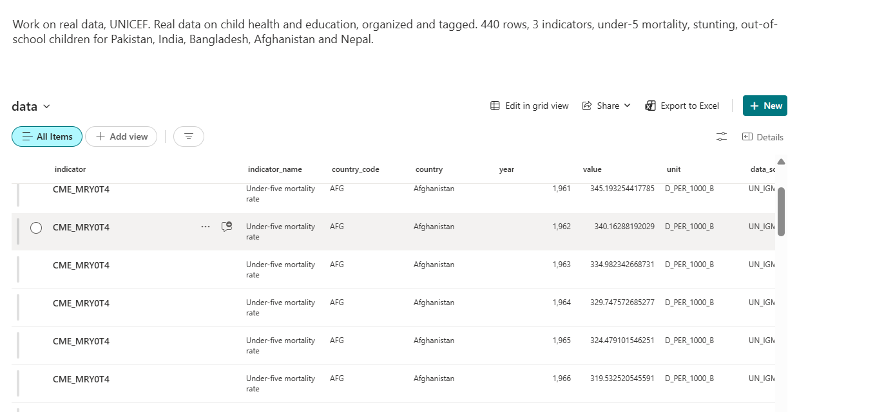

# UNICEF Data Hub

**Live demo — open it and try the search: https://awaisahmed183.github.io/unicef-data-hub/**

A data hub I built to organise real UNICEF public data — under-5 mortality, stunting, and out-of-school rates for Pakistan, India, Bangladesh, Afghanistan and Nepal — so anyone can find a number fast: search it, filter by topic, and see the latest value per country with the Pakistan trend.

The data is fetched live from the UNICEF Data Warehouse (SDMX API, https://sdmx.data.unicef.org), tagged with metadata, and built into a searchable page. **440 rows, 3 indicators, 5 countries**, fetched 10 November 2026.

## Indicators (3, all public)

| Indicator | What it is | Pakistan, latest |
|---|---|---|
| `CME_MRY0T4` | Under-five mortality rate (deaths per 1,000 live births) | **56.0** (2024) |
| `NT_ANT_HAZ_NE2` | Stunting — height-for-age below −2 SD, % of children under 5 | **37.6%** (2018) |
| `ED_ROFST_L1` | Out-of-school rate, primary school age, % | **23.0%** (2018) |

Total only (both sexes, all wealth groups). Figures are UNICEF estimates and can be revised — check every number at https://data.unicef.org.

## SharePoint — same data, organised and tagged

The same 440 rows are also published as a SharePoint list, with metadata on every row (indicator, country, year, value, unit, source). I designed the SharePoint site and pages, tagged the content, and keep it connected and up to date.



The SharePoint site lives in my student Microsoft 365 tenant, so it opens only for people in that tenant — the screenshot above is the proof.

## Run it

```bash
pip install unicefdata pandas
python3 fetch_data.py   # live fetch from UNICEF, writes data.csv
python3 build_hub.py    # checks the data, writes index.html
# then open index.html in any browser — search and filter work offline
```

`fetch_data.py` pulls the three indicators for the five countries from the public SDMX API (no key, no login). `build_hub.py` (standard library only) validates the data and builds the page: latest value per country, Pakistan trend, and search/filter by keyword and topic.

## What this is, honestly

My own project, built to do knowledge-management work properly: get real data, organise it, tag it with metadata, and keep it findable and up to date — in a live hub and in SharePoint.

It is **not** UNICEF work and **not** an official UNICEF page. No UNICEF content or branding is used beyond the public data itself, credited to its source.

Author: Awais Ahmed Shah, final-year BS Data Science student, UET Peshawar.
